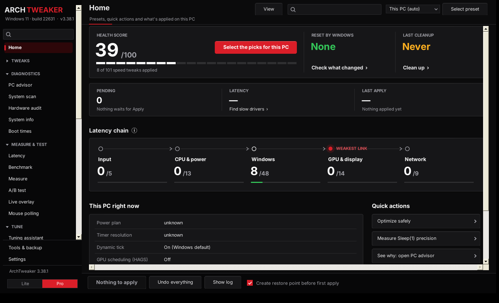
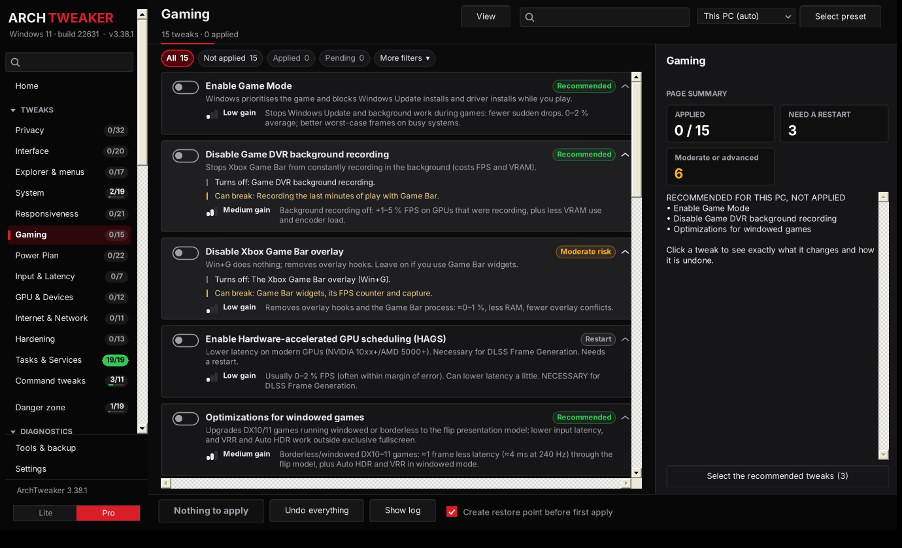
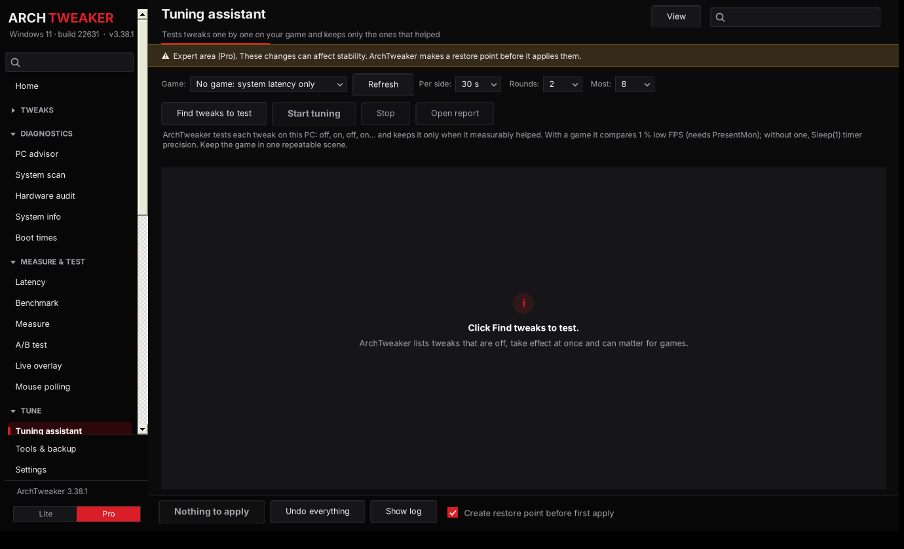

# ArchTweaker 3.38.2

**Why ArchTweaker:** measured, not promised (A/B test any tweak on this PC and keep only the measured wins); exactly undoable; works offline with no account; one small program of about 4 MB; open about every tweak's risk and evidence.

An original Windows 10/11 tweaker for maximum performance and the lowest latency. It measures what each change does on your PC and undoes every change exactly. Black & red dark theme and a light theme, English and Russian.

**Free for everyone.** No internet needed, no account, no sign-in, no registration. Download the exe and run it.

**Comments and suggestions are welcome.** Open an [issue](https://github.com/arttnomadd/ArchTweaker/issues/new) for a bug, an idea, a tweak you want added, or any feedback.



## Download
Get `ArchTweaker.exe` from the [latest release](https://github.com/arttnomadd/ArchTweaker/releases/latest). Each release also has a zip with the full source and a `SHA256SUMS.txt`, so you can check the file you downloaded:
```
certutil -hashfile ArchTweaker.exe SHA256
```

**Run:** `ArchTweaker.exe`. It asks for administrator rights and needs .NET Framework 4.x, which is built into Windows 10/11. Single file, no install.
Data, backups and reports are in `C:\ProgramData\ArchTweaker\`.

**Requirements:** Windows 10 or 11 (x64), an administrator account, .NET Framework 4.5 or later (in the box on every supported Windows). No internet needed, except for update checks, hosts list downloads and the optional PresentMon download.

SmartScreen can warn about a new, unsigned program. Click **More info → Run anyway**, or build the exe yourself from this source (see [Build](#build)).

- **What changed in each version:** [docs/CHANGELOG.md](docs/CHANGELOG.md) (also in the app: View → What's new).
- **Every tweak with its expected gain:** [docs/TWEAKS.md](docs/TWEAKS.md) (280 tweaks).
- **Design rules:** [docs/DESIGN.md](docs/DESIGN.md). **Architecture decisions:** [docs/adr/](docs/adr/).

## Features
- **280 tweaks in 14 categories.** Each one reads its real state live, shows its risk, what it can break and its expected gain, and is undone exactly.
- **Measure before you keep.** Latency (DPC/ISR), Benchmark with 1 % lows (PresentMon), A/B test and the Tuning assistant, which keeps a tweak only when a Welch's t-test shows at least a 1 % gain on your PC.
- **Live overlay.** FPS, 1 % low, DPC/ISR time, interrupts per second and timer resolution in a click-through corner box (Ctrl+Shift+F10).
- **Tuners (Pro).** Interrupt tuner (MSI mode, affinity, priority), Power tuner (A/B tests power-plan values), Tune everything.
- **PC advisor and Hardware audit.** Finds what holds this PC back: RAM below its rated speed, PCIe link, BIOS settings, drivers, overlays.
- **Cleanup and apps.** Cleanup with an allowlist of safe paths, Deep clean, Disk space, Uninstaller, UWP apps, Startup, Services.
- **Windows tools.** Hosts blocker with maintained block lists (StevenBlack, HaGeZi, AdAway and more) and their dates, Context menu, Drivers, Power settings, Bake into ISO (puts registry tweaks into a Windows image offline).
- **Drift guard.** When Windows Update or a driver sets an applied tweak back, a bar says so and re-applies it on your click.
- **English and Russian**, dark and light themes, keyboard navigation (Ctrl+K finds any page).



## Lite and Pro
**Lite** (the default) shows only safe tweaks and the everyday pages. **Pro** adds the advanced, experimental and Danger zone tweaks and the expert tools (tuners, A/B test, services, drivers, ISO). Pro asks you to read a short disclaimer first, and can have a PIN. The switch is at the bottom of the sidebar.

## Sidebar
| Section | Pages |
|---|---|
| Home | Latency chain, live vitals, Optimize safely |
| Tweaks | 14 categories: Privacy, Interface, Explorer & menus, System, Responsiveness, Gaming, Power Plan, Input & Latency, GPU & Devices, Internet & Network, Hardening, Tasks & Services, Command tweaks, Danger zone (Pro) |
| Diagnostics | PC advisor, System scan, Hardware audit, System info, Boot times |
| Measure & test | Latency, Benchmark, Measure, A/B test (Pro), Live overlay, Mouse polling |
| Tune (Pro) | Tuning assistant, Interrupt tuner, Power tuner, Tune everything |
| History | What changed, Results, Change history |
| Clean & apps | Cleanup, Deep clean (Pro), Disk space, Uninstaller, Apps (UWP) (Pro), Startup, Services (Pro) |
| Windows tools | Power settings (Pro), Context menu, Hosts blocker (Pro), Drivers (Pro), Bake into ISO (Pro) |
| Tools & backup | Restore point, recovery kit, profiles, drivers export, repairs, Pro tools |
| Settings | Language, colour scheme, notification area icon, Lite / Pro mode and PIN, What's new, tour |

Find a page: the box at the top of the sidebar, or Ctrl+K.

## Honest notes on performance
Most single tweaks give 0–3%. The biggest, most reliable wins for 1440p/240 Hz gaming are:
1. The Power Plan category (EPP 0, Aggressive boost, no parking, PCIe/USB power saving off).
2. HAGS, Game Mode, Game DVR off, and windowed-game optimizations.
3. Timer resolution together with dynamic tick off.
4. XMP/EXPO enabled in BIOS (check System info: configured vs rated RAM speed).
5. Fewer background services and tasks.

Tweaks marked **moderate** or **advanced** trade something away (heat, security, features). The details panel says exactly what.
*Disable CPU idle states* can **lower** boost clocks on modern CPUs, so benchmark it before keeping it.

## How it works
- **Checkbox on = applied**: each row reads its current state live from the registry, services, tasks or power plan.
- Flip the toggles, then click **Apply** (Ctrl+Enter) and confirm in the review dialog. Reverts run first, then applies in catalog order, so the power plan is created before its settings.
- A restore point is created before the first apply. Every original registry value is journaled. **Undo everything** first reverts ArchTweaker's non-registry changes (power plan, commands, tasks, timer service, hosts block), then restores each registry value exactly. **Undo last apply** reverts just the most recent batch.
- Per-device and power-plan tweaks store each device's or setting's own previous value and restore it when unticked.
- Drift guard: if a Windows update, a driver or another program sets an applied tweak back, a bar says so and "Re-apply them" fixes it.

## Command line
```
ArchTweaker.exe /preset Gaming | /preset Auto | /hostsupdate | /apply profile.atp | /clean | /undo   [/silent]
```



## Updates
**Tools & backup → Check for updates** reads [`latest.json`](latest.json) from this repository. The file is signed with RSA-3072 (SHA-256). The app holds only the public key, and it refuses a manifest with a bad signature, an older serial, or a download address outside GitHub. It then checks the SHA-256 of the downloaded exe before it replaces itself. Details: [ADR-0005](docs/adr/0005-self-update-trust-model.md) and [ADR-0008](docs/adr/0008-signed-update-manifest.md).

## Safety
- Every registry change is journaled with its original value; **Undo everything** restores it exactly ([ADR-0002](docs/adr/0002-journal-based-exact-undo.md)).
- A Windows restore point is made before the first apply.
- Deleted registry keys are exported to a `.reg` file first. If the export fails, nothing is deleted.
- The cleaner deletes only files on an allowlist of known-safe paths ([ADR-0003](docs/adr/0003-winapp2-allowlist-file-only-cleaner.md)).
- Lite mode hides every tweak above "safe". Pro shows a disclaimer first and can have a PIN.

## Build
**On Windows:** run `build.bat`. It uses the C# compiler built into Windows (.NET Framework 4). No SDK needed. The exe goes to `out\ArchTweaker.exe`.

**On Linux (Mono):**
```sh
bash tools/build-win.sh 3.38.2.0 out/ArchTweaker.exe   # compiles against the .NET 4.5 reference assemblies, then audits the IL
sh tools/run-tests.sh                                   # unit tests, must end "N passed, 0 failed"
```
The code is C# 5 so that the compiler in the box on Windows can build it ([ADR-0001](docs/adr/0001-mono-build-against-dotnet45-refs.md)). CI builds and tests on Windows Server 2022 and 2025 ([.github/workflows/windows.yml](.github/workflows/windows.yml)).

## Project layout
| Folder | What is in it |
|---|---|
| `src/App` | Start-up, command line, self-update |
| `src/Core`, `src/Safety` | Registry journal, undo, restore points, shell runner |
| `src/Catalog` | Every tweak, grouped by category, with its expected gain |
| `src/Measure`, `src/Power`, `src/Hardware`, `src/Network` | Benchmarks, latency, tuners, device and power code |
| `src/Cleanup`, `src/Iso`, `src/Modes` | Cleaner, hosts blocker, Bake into ISO, Lite/Pro |
| `src/Ui` | Window, pages and owner-drawn controls |
| `src/Generated` | Changelog and Russian text, made by `tools/gen_*.py` |
| `Tests`, `e2e` | Unit tests (Mono or Windows) and Windows UI tests (pywinauto) |
| `lang` | Translations (`ru.tsv`) |
| `docs` | Changelog, tweak list, design rules, ADRs, screenshots |
| `tools` | Build, tests, signer, generators |

## Credits
Several device, power-plan and registry tweaks are adapted from the WinSux scripts by FR33THY (MIT License), which you provided. Each was re-implemented with live detection and an exact undo. Research sources: Microsoft power-settings and StorNVMe power documentation, Intel Wi-Fi roaming guidance, djdallmann/GamingPCSetup, valleyofdoom/PC-Tuning, Blur Busters forums, heise/Neowin (native NVMe).

## Notes
- Command tweaks run once when applied. Their checkbox shows what ArchTweaker applied.
- Defender may flag the hosts blocker (HostsFileHijack). That's expected for any hosts file that blocks Microsoft domains.
- 'Disable Defender real-time' needs Tamper Protection off first.
- Removed apps and cleaned files can't be restored by Undo.
- Log: `C:\ProgramData\ArchTweaker\archtweaker.log`
